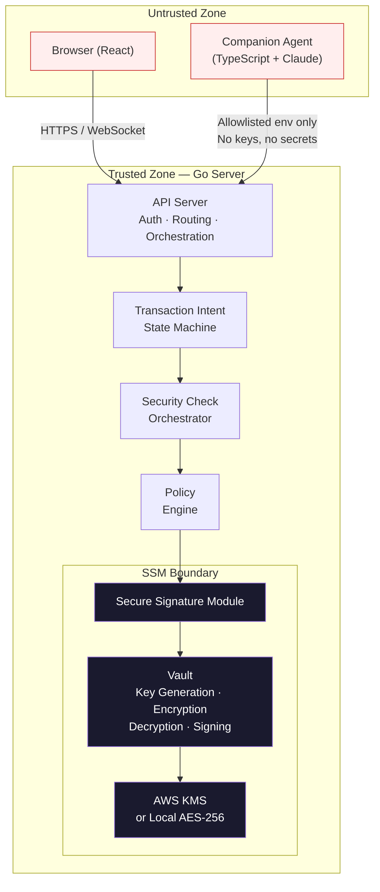
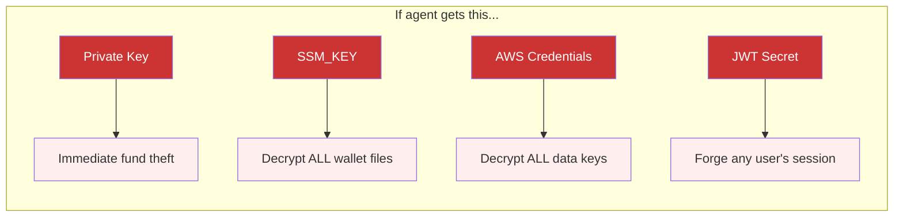
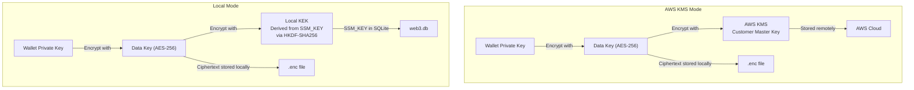
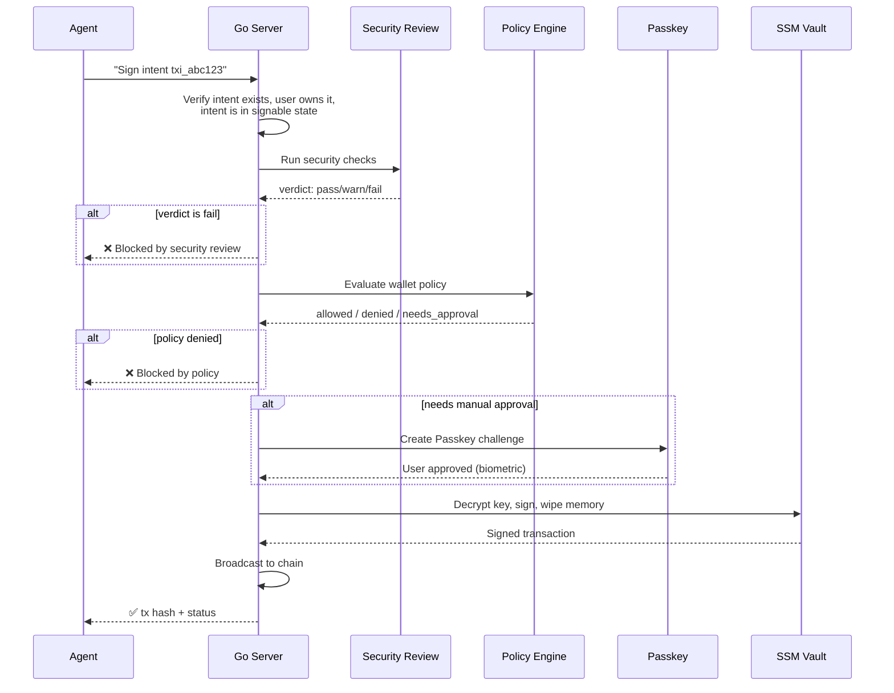
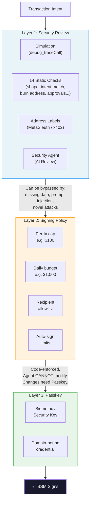
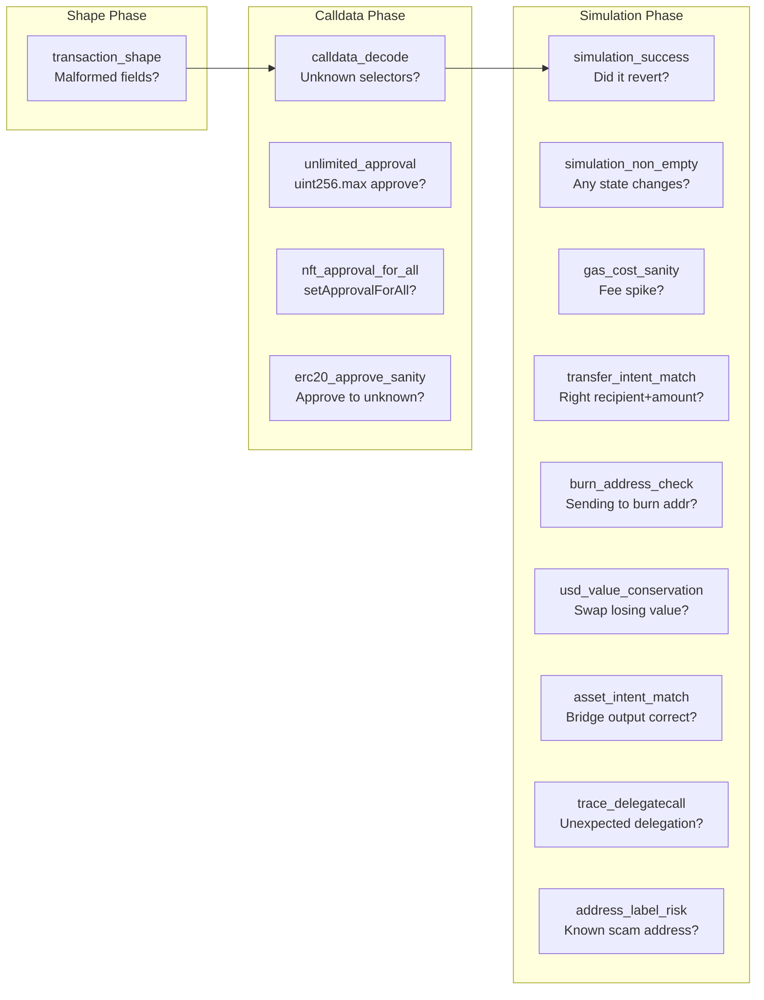
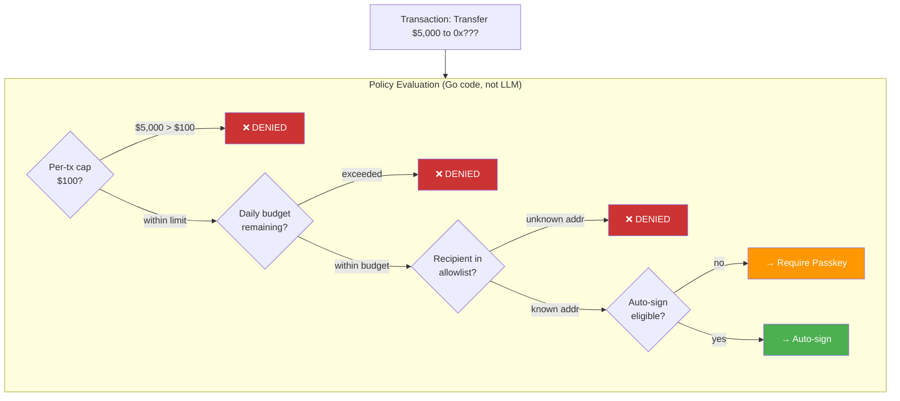
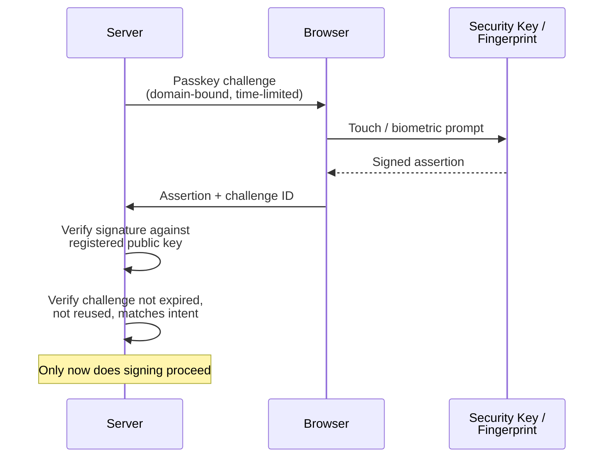
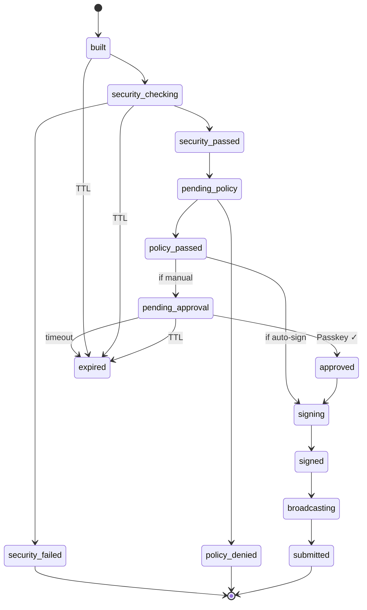
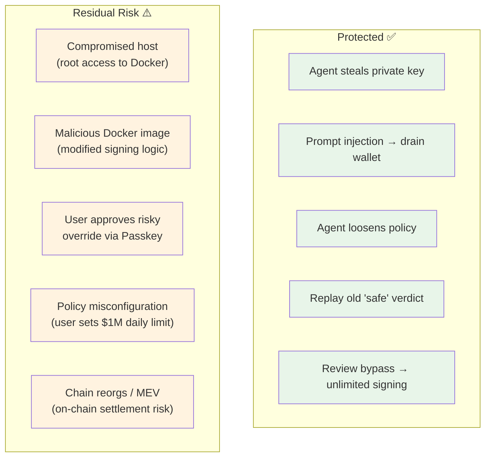

# Web3 Companion Security Design

[简体中文](SECURITY_DESIGN.zh.md)

## Why Web3 Needs AI Agents — and Why Existing Agents Are Dangerous

Web3 is complex. Users must navigate token approvals, gas estimation, bridge routing, delegation, and signing across multiple chains. An AI companion that can inspect assets, prepare transactions, and explain security implications reduces friction and error.

But giving an AI agent access to a crypto wallet is fundamentally different from giving it access to a calendar or email. In Web3, **a bad transaction settles permanently** — there is no chargeback, no support escalation, and no undo. A single malicious signing event can drain an entire wallet in one block.

### The OpenClaw Crisis of 2026

The security failure of [OpenClaw](https://www.oasis.security/blog/openclaw-vulnerability) — the open-source AI agent that reached 100,000 GitHub stars in five days — demonstrated exactly what goes wrong when an AI agent operates without security boundaries:

- **Private keys in agent memory.** OpenClaw stored credentials and wallet keys in local Markdown files accessible to the agent process. A [prompt injection through a linked email inbox](https://www.kaspersky.com/blog/openclaw-vulnerabilities-exposed/55263/) was enough to exfiltrate the private key.
- **No signing isolation.** The same process that read untrusted web content also had signing authority. A [1-click RCE exploit (CVE-2026-25253)](https://depthfirst.com/post/1-click-rce-to-steal-your-moltbot-data-and-keys) allowed a malicious webpage to take full control of the agent and its keys.
- **Marketplace supply chain attacks.** Security researchers found that [7.1% of skills in the ClawHub marketplace](https://www.theregister.com/2026/02/05/openclaw_skills_marketplace_leaky_security/) contained credential-leaking flaws, including skills that actively drained crypto wallets.
- **No policy layer.** There was no infrastructure-level limit on what the agent could sign. If the agent was tricked, there was nothing between the prompt injection and fund transfer.

The result: [over 135,000 vulnerable agent instances exposed](https://blockeden.xyz/blog/2026/03/12/openclaw-lobster-ai-gateway-web3-security-crisis/), with documented wallet drains and credential theft at scale.

### The Fundamental Problem

The core issue is architectural, not incidental. LLMs cannot reliably distinguish instructions from data — [tokens from system prompts, user messages, and retrieved content are all processed identically](https://www.blockchain-council.org/ai/prompt-injection-2026-disregard-previous-instructions-web3-security/). This means:

1. **Prompt injection is not fully solvable at the model layer.** An attacker can embed instructions in any content the agent reads — a token name, a contract comment, a webpage, an email. If the agent has signing authority, the injection becomes a fund drain.
2. **The agent's security review can be bypassed.** An LLM's safety analysis of a transaction is only as reliable as its context. Manipulated context → manipulated verdict → malicious signing.
3. **The attack surface is continuous.** Agents run unattended, ingest untrusted content at machine speed, and take actions without human review. Any compromise compounds silently.

The security community's conclusion is clear: [AI models with key access are a risky bet for Web3](https://www.ccn.com/opinion/technology/ai-models-with-key-access-risky-bet-web3/). The solution is not to avoid agents, but to **harden the architecture around the model** so that a compromised or tricked LLM cannot cause irreversible damage.

---

## Design Principles

Web3 Companion was designed from the ground up with the assumption that **the AI agent will be tricked**. The architecture ensures that even a fully compromised agent cannot drain the wallet.

### Principle 1: The Agent Must Never Touch Private Keys

The private key is the one credential that gives absolute control over on-chain assets. If the agent can read the key, any compromise of the agent can reach the key.

**Design decision:** Private keys exist only inside the Secure Signature Module (SSM), a separate Go process boundary. The companion agent, browser frontend, and Claude process never receive key material. They work with transaction identifiers and wallet IDs — opaque references that cannot be used to sign independently.

### Principle 2: Preparation ≠ Authorization

Preparing a transaction intent is a fundamentally different operation from authorizing it. The agent may help the user understand state and build an intent, but the decision to sign must pass through backend-controlled gates that the agent cannot bypass.

**Design decision:** Every write action creates a backend transaction intent that must clear seven sequential stages: delegation check → simulation → security checks → Security Agent review → policy evaluation → Passkey approval → SSM signing. Each stage produces explicit state. A successful earlier stage does not skip later controls.

### Principle 3: Review Is Detection, Not Enforcement

Transaction simulation, calldata analysis, and address-label lookups are valuable — they catch common attack patterns and explain risks to the user. But they are not the final safety boundary. Simulations can fail, labels can be missing, and an LLM's security analysis can be manipulated through prompt injection.

**Design decision:** Security review is treated as a risk signal and explanation layer. The final enforcement layer is the hard policy + Passkey. Even when every security check passes, the wallet's signing policy still applies. Even when the Security Agent says "safe," the user still needs to approve via Passkey if the policy requires it.

### Principle 4: Hard Policy as the Safety Net

If the agent is tricked into requesting a $100,000 transfer, and the security review is manipulated into saying "safe," **the policy must still block it** if the daily limit is $1,000.

**Design decision:** Wallet signing policies define hard, code-enforced limits: per-transaction caps, daily budgets, recipient allowlists, and auto-sign thresholds. Policies cannot be modified by the agent — changes require Passkey approval. The default policy for new wallets has auto-sign disabled.

### Principle 5: Fail Closed on Uncertainty

A scan failure is not a pass. Missing data is not safe data.

**Design decision:** When security evidence is missing, contradictory, stale, or insufficient, the system stops for explicit user confirmation. This applies to: failed simulations, unavailable trace data, stale transaction intents, missing balance-change evidence, and address-label provider failures.

---

## Module 1: Private Key Security

### The Problem We Faced

We wanted an AI assistant that could prepare on-chain transactions — but the moment you give an agent signing capability, you've given it the power to move real money. Every Web3 agent hack in 2025–2026 followed the same pattern: the agent process held the private key, and the attacker found a way to reach it.

We asked ourselves: **what if the agent simply cannot sign?** Not "shouldn't" — *cannot*, by architecture. What if the private key lives in a place the agent has no path to reach, regardless of how thoroughly it's compromised?

### The Decision: An Impenetrable Boundary

We chose to build a hard process boundary. The Secure Signature Module (SSM) is the only component that ever touches private keys. The agent communicates through opaque intent IDs — it can ask "please sign intent `txi_abc123`," but it never sees what that request unlocks.

This is not a permissions check. It's a physical separation. The agent's process literally does not have the key material in its memory, environment, or filesystem.



### How We Enforce Isolation

The Go server starts the companion agent with an **explicit environment allowlist**. We don't filter out dangerous values — we only pass the safe ones. This is a whitelist, not a blacklist. Everything not explicitly allowed is absent.

The things that must never reach the agent, and what happens if they did:



Model authentication is the one credential the agent needs to function. Rather than putting it in the process environment (where any code in the process can read it), we write it to a per-user `settings.json` file that the Claude Agent SDK reads directly. The agent code itself never handles the raw API key.

### The Encryption Story

We considered three approaches for key storage:

1. **Plaintext files.** Fast, simple, catastrophic if the disk is compromised. Rejected.
2. **Password-derived encryption.** Requires the user to enter a password on every restart. Poor UX for a Docker service. Rejected.
3. **Envelope encryption.** Each wallet key is encrypted with a unique data key. The data key itself is encrypted by a master key (AWS KMS or local AES-256). Even if the encrypted files are stolen, they're useless without the master key.

We chose envelope encryption. Two modes, same interface:



The key insight: in AWS KMS mode, stealing the server gives you encrypted blobs that are worthless without AWS credentials. The private key only exists in plaintext inside the SSM process memory, for the duration of one signing operation, then it's zeroed.

### What Happens When Someone Asks to Sign

Every signing request follows the same path. There are no shortcuts, no "fast path" that skips checks. The agent's request enters at the top and must survive every gate:



At no point does the agent receive the private key. It receives only the transaction hash and broadcast status.

### The One Exception: Wallet Export

Wallet export is the **only** operation that reveals the private key. We debated whether to include it at all. The argument for: users who want to leave Web3 Companion should be able to take their keys with them. The argument against: any key exposure is a risk.

We compromised: export requires Passkey, shows the key once, and **immediately removes the wallet from management**. Once you export, Web3 Companion no longer signs for that wallet. The user is taking custody — we're no longer in the picture.

---

## Module 2: Transaction Security

### The Problem We Faced

Even with perfect key isolation, a compromised agent can still cause harm: it can prepare *legitimate-looking* transaction intents that trick the user or exploit auto-sign policies. Prompt injection doesn't need the private key if it can convince the system to sign a malicious transaction through normal channels.

We needed to answer: **how do you catch a bad transaction when the entity preparing it might be lying to you?**

### The Insight: No Single Layer Is Enough

We considered several approaches:

- **Transaction simulation only.** Simulate the transaction, check the results. Problem: simulations can fail, RPCs can be unavailable, novel attacks won't match known patterns.
- **LLM security review only.** Have the AI analyze the transaction. Problem: the same prompt injection that caused the bad transaction can also manipulate the review.
- **Hard policy only.** Cap every transaction at $100. Problem: legitimate users need flexibility. A $100 cap on a swap is unnecessarily restrictive.

None of these alone is sufficient. But **combined**, they create a defense where each layer catches what the others miss:



The critical design decision: **each layer assumes the previous layer has been fully compromised.** Layer 2 doesn't trust Layer 1's verdict. Layer 3 doesn't trust Layer 2's policy evaluation. This is defense in depth, not defense in series.

### Layer 1: Security Review — "Is This Transaction Safe?"

The security review layer runs 14 deterministic checks after transaction build and before signing. Each check targets a specific attack pattern:



Each check produces `pass`, `warn`, `fail`, or `skipped`. The overall verdict is the worst individual result. A single `fail` blocks signing.

**But we know this isn't enough.** Here's why we built Layer 2:

- Public RPCs often don't support `debug_traceCall` — simulation is unavailable
- Token metadata and address labels can be incomplete or stale
- Some contracts hide behavior behind dynamic calls or proxy patterns
- Aggregator routes can change between quote and execution
- **A prompt injection can manipulate the Security Agent's reasoning about the checks**

When a prompt injection tells the Security Agent "this DELEGATECALL is expected behavior" — and the agent believes it — the review layer has been bypassed. That's when the policy layer saves you.

### Layer 2: Signing Policy — "Is This Transaction Allowed?"

This is the hard safety boundary. The wallet signing policy is **code-enforced, not LLM-decided**. The agent cannot modify it, reason about it, or argue with it. It's a set of numeric limits that the Go server evaluates — the LLM is not involved.



The key design choices and their rationale:

**Why policy changes require Passkey.** If the agent could modify policies, a prompt injection could first loosen the limits, then drain the wallet. By requiring Passkey for policy changes, we ensure an attacker needs the user's physical biometric — not just control of the agent.

**Why auto-sign is off by default.** New wallets receive the `default` manual policy. Every transaction requires Passkey until the user explicitly enables auto-sign and sets limits. This is intentionally conservative — the user must opt in to automation, not opt out of safety.

**Why policy is per-wallet, not global.** A user might want strict limits on their main wallet ($50/tx, manual only) but looser limits on a testing wallet ($500/tx, auto-sign enabled). Per-wallet policies allow this granularity.

### Layer 3: Passkey — "Does the Human Confirm?"

When the policy says "manual approval required," the system creates a WebAuthn challenge. This is the final gate — it cannot be passed by software alone.



Why Passkey instead of a simple "confirm" button:

- **Phishing-resistant.** The credential is domain-bound. A Passkey registered on `companion.example.com` physically cannot be used on `attacker.com`.
- **Hardware-bound.** The private key of the Passkey lives in a secure enclave (TPM, Secure Enclave, or USB security key). It cannot be exported or copied.
- **Presence-proving.** The biometric or PIN proves a real human is physically present, not a script.

### The Transaction Intent State Machine

We learned from DeFi exploits that one of the most dangerous patterns is "verdict reuse" — applying an old "safe" verdict to a modified transaction. To prevent this, every write action creates a unique intent with explicit state transitions:



A security review clears only the **exact intent** it reviewed. If the agent rebuilds the transaction (different calldata, different amount, different recipient), it's a new intent that starts at `built` and must pass all checks again. This prevents the attack where a malicious agent gets a "safe" verdict on a small transfer, then swaps in a large drain.

---

## Module 3: Random Number Generation (RNG)

### The Problem We Faced

Every cryptographic operation in Web3 Companion depends on unpredictable random numbers: private key generation, AES-GCM nonce creation, authentication token issuance, WebAuthn challenge bytes, and key encryption key derivation. A weak or predictable RNG at any of these points would undermine the entire security architecture — a biased private key can be brute-forced, a reused nonce leaks the AES key, and a predictable challenge enables replay attacks.

The OpenClaw codebase used `math/rand` (a deterministic PRNG seeded from the system clock) for several security-critical paths. Researchers demonstrated that an attacker who observed two consecutive token values could reconstruct the PRNG state and predict every future token, challenge, and — in some forks — wallet key.

### The Decision: crypto/rand Everywhere, No Exceptions

We enforce a single rule: **every byte of randomness in the system comes from `crypto/rand`**. This is the Go standard library's interface to the operating system's cryptographically secure pseudorandom number generator (CSPRNG), backed by `getrandom(2)` on Linux and equivalent syscalls on other platforms.

There is no `math/rand` import anywhere in the security-critical codebase. This is verified by test and by CI secret scans.

### Where Randomness Is Used

| Operation | Bytes | Source | Error Handling |
|-----------|-------|--------|----------------|
| Private key generation (secp256k1) | 32 | `crypto.GenerateKey()` → `crypto/rand.Reader` | Error propagated; wallet creation fails |
| AES-256-GCM nonce | 12 | `io.ReadFull(rand.Reader, nonce)` | Error propagated; encryption fails |
| AES-256 data key | 32 | `io.ReadFull(rand.Reader, key)` | Error propagated; key generation fails |
| JWT secret (auto-generated) | 64 | `rand.Read(b)` | Error propagated; server startup fails |
| SSM root key (auto-generated) | 32 | `rand.Read(b)` | Error propagated; server startup fails |
| Refresh token | 32 | `rand.Read(b)` | Error propagated; token issuance fails |
| WebAuthn challenge | 32 | `rand.Read(b)` | Panic (CSPRNG failure = unsafe state) |
| Challenge ID | 16 | `rand.Read(b)` | Panic |
| Auth token / session ID | 32 / 12 | `rand.Read(b)` | Panic |
| Request ID | 16 | `rand.Read(b)` | Panic |
| Secure file deletion overwrite | file size | `rand.Read(randomData)` | Error propagated; deletion aborted |

### Error Handling Strategy

We use two error handling strategies depending on the operation:

1. **Error propagation** for operations where the caller can handle failure gracefully (key generation, encryption, token issuance). The operation fails cleanly and the caller receives an error.

2. **Panic** for operations where CSPRNG failure means the process is in an unsafe state and no subsequent cryptographic operation can be trusted (challenge generation, session tokens). On Go 1.22+, `crypto/rand.Read` is documented as never returning an error on supported platforms, so this panic path is unreachable in practice — but it ensures the process halts rather than silently using predictable output if the impossible occurs.

### Key Derivation

The local-mode Key Encryption Key (KEK) is derived from the user-supplied `WEB3_SSM_KEY` using HKDF (HMAC-based Extract-and-Expand Key Derivation Function, RFC 5869):

```
KEK = HKDF-SHA256(
    IKM  = WEB3_SSM_KEY,
    salt = "web3-companion:ssm",
    info = "kek-derivation:v1"
)  →  32 bytes (AES-256)
```

HKDF is the standard KDF for deriving keys from high-entropy input material. The salt provides domain separation (keys derived for this application cannot collide with keys derived by other applications using the same root key), and the info string provides context binding (the KEK derivation is distinct from any future derivation we might add).

The root key minimum length is 32 bytes (256 bits), enforced at startup. When auto-generated by the setup flow, the root key is 32 bytes of `crypto/rand` output, providing 256 bits of entropy.

### Nonce Management

AES-256-GCM requires a unique nonce for every encryption under the same key. We generate each nonce from `crypto/rand.Reader` (12 random bytes). With a 96-bit random nonce, the birthday-bound collision probability reaches 2^-32 after ~2^48 encryptions under the same key — far beyond the operational lifetime of any single data key in this system, where each data key encrypts exactly one private key.

### What We Explicitly Avoid

- **`math/rand`** — deterministic PRNG, not suitable for any security purpose
- **Time-based seeding** — observable and predictable
- **Nonce counters** — require persistent state that can desynchronize across restarts
- **Key reuse** — each wallet private key gets its own unique data key
- **Custom CSPRNG implementations** — we use the OS-provided entropy source exclusively

---

## Auditability

Security events are meaningless if they can't be reviewed after the fact. The system logs:

- Account registration and login events
- Wallet creation, deletion, and export
- Policy creation and modification
- Transaction intent lifecycle (build → check → sign → broadcast)
- Security verdicts and overrides
- Passkey challenge creation and completion
- Signing and broadcast results

These logs help users understand what happened and help developers investigate unexpected behavior.

---

## What Can Still Go Wrong

No security design eliminates all risk. Here's what we protect against and what remains:



Our mitigation advice: use small limits, manual approval for high-value actions, trace-capable RPC endpoints, and conservative policy defaults. Protect the host, Docker daemon, volumes, and backups.

---

## Bringing It Together

Let's return to the question we started with: **how do you build a Web3 AI agent that can't drain the wallet, even when it's fully compromised?**

The answer is not one mechanism — it's the interaction between three independent boundaries that don't trust each other.

**The private key boundary** ensures the agent never has the raw material to sign. Even if an attacker takes complete control of the companion process — reads its memory, modifies its code, intercepts every message — they find no keys. They can craft the most persuasive transaction intent in the world, but they can't sign it themselves.

**The policy boundary** ensures that even legitimate-looking intents face hard numeric limits. A prompt injection might convince the security review that a $50,000 transfer is safe. It doesn't matter — if the daily budget is $1,000, the transaction is denied. The policy is evaluated by Go code, not by the LLM. The attacker would need to change the policy first, but that requires...

**The Passkey boundary** ensures a human is physically present for every sensitive decision. Policy changes, manual signing, wallet export, security overrides — all require a hardware-bound biometric challenge that no software exploit can simulate.

Each boundary is designed to hold independently. If the security review is perfect, the policy and Passkey are redundant safety nets. If the security review is completely bypassed, the policy still enforces hard limits. If both the review and the policy are somehow defeated, the Passkey still requires the user's fingerprint.

This layered approach is our answer to the fundamental tension of Web3 AI agents: **users want the convenience of automation, but the irreversibility of blockchain demands stronger safety guarantees than any single mechanism can provide.**

| If this is compromised... | These still protect you |
|--------------------------|----------------------|
| Agent (prompt injection, RCE) | No keys → can't sign. Policy → can't exceed limits. Passkey → can't approve. |
| Security review (manipulated verdict) | Policy → hard limits regardless. Passkey → manual approval still required. |
| Policy (misconfigured by user) | Passkey → every manual-required action still needs biometric. |
| Everything except Passkey | Hardware-bound credential → attacker needs the user's physical body. |

---

*Web3 Companion is an open-source research version and has not completed a comprehensive production security audit. This document describes intended security boundaries and implementation expectations. It is not a security guarantee.*

*References:*
- *[AI Models with Key Access Are a Risky Bet for Web3](https://www.ccn.com/opinion/technology/ai-models-with-key-access-risky-bet-web3/) — CCN*
- *[ClawJacked: OpenClaw Vulnerability Enables Full Agent Takeover](https://www.oasis.security/blog/openclaw-vulnerability) — Oasis Security*
- *[Prompt Injection in 2026 for Web3 Security](https://www.blockchain-council.org/ai/prompt-injection-2026-disregard-previous-instructions-web3-security/) — Blockchain Council*
- *[OpenClaw's 'Lobster Fever' Became Web3's Biggest Security Wake-Up Call of 2026](https://blockeden.xyz/blog/2026/03/12/openclaw-lobster-ai-gateway-web3-security-crisis/) — BlockEden*
- *[Agentic AI Security Risks in Web3](https://sherlock.xyz/post/agentic-ai-security-risks-in-web3-what-protocols-need-to-know-in-2026) — Sherlock*
- *[As AI agents scale in crypto, researchers warn of a critical security gap](https://www.coindesk.com/tech/2026/04/13/ai-agents-are-set-to-power-crypto-payments-but-a-hidden-flaw-could-expose-wallets) — CoinDesk*
