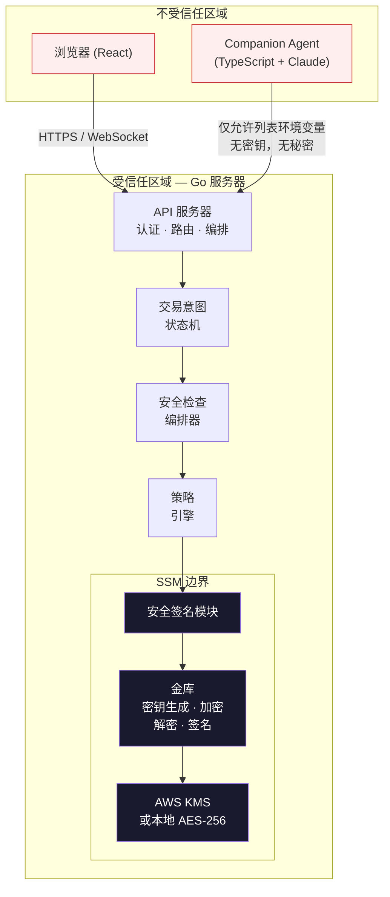
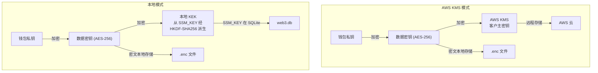
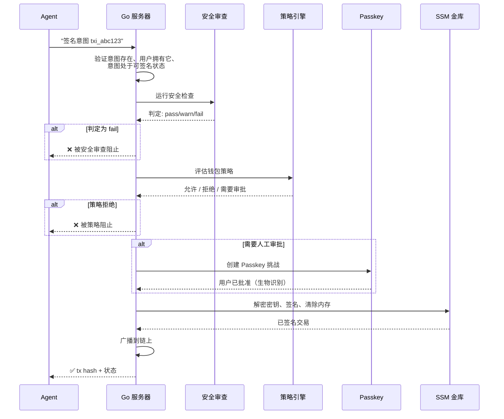
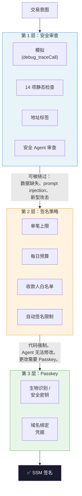
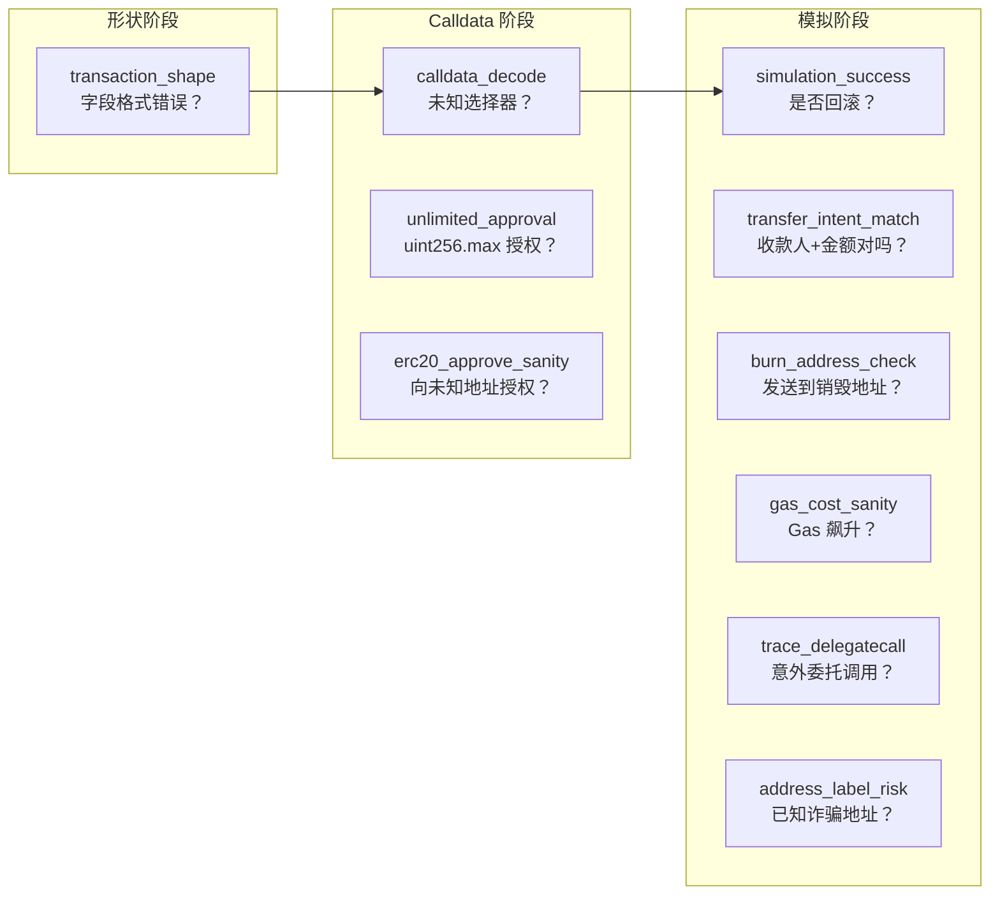
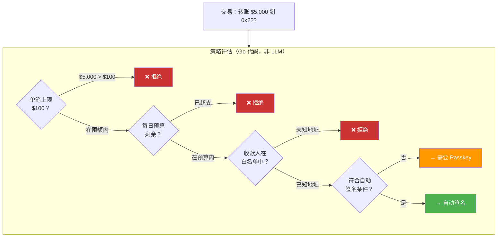
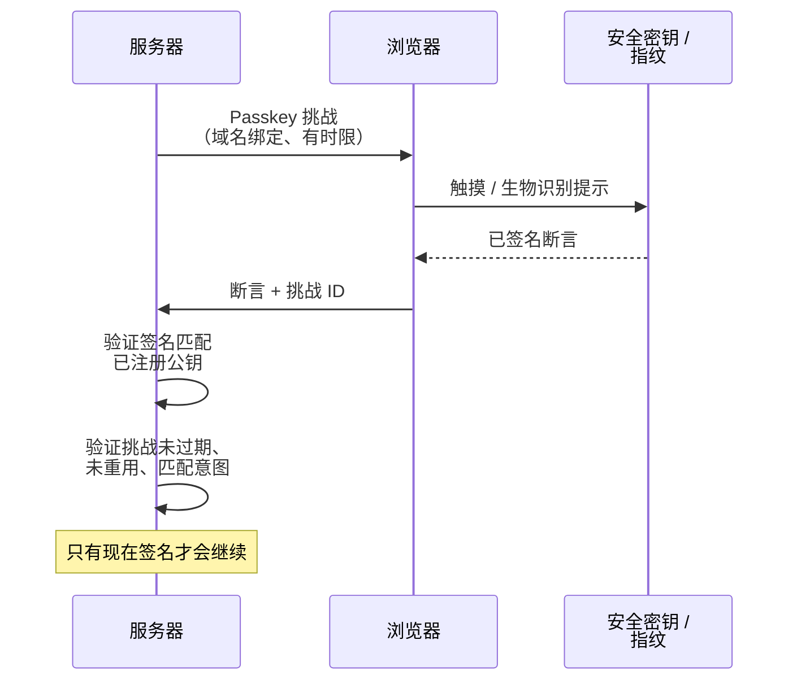
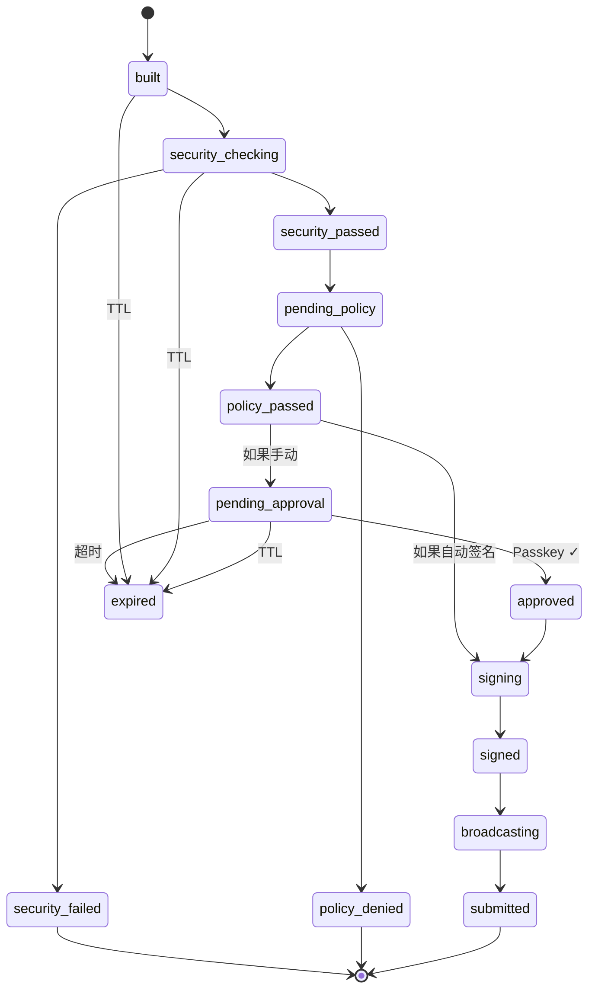
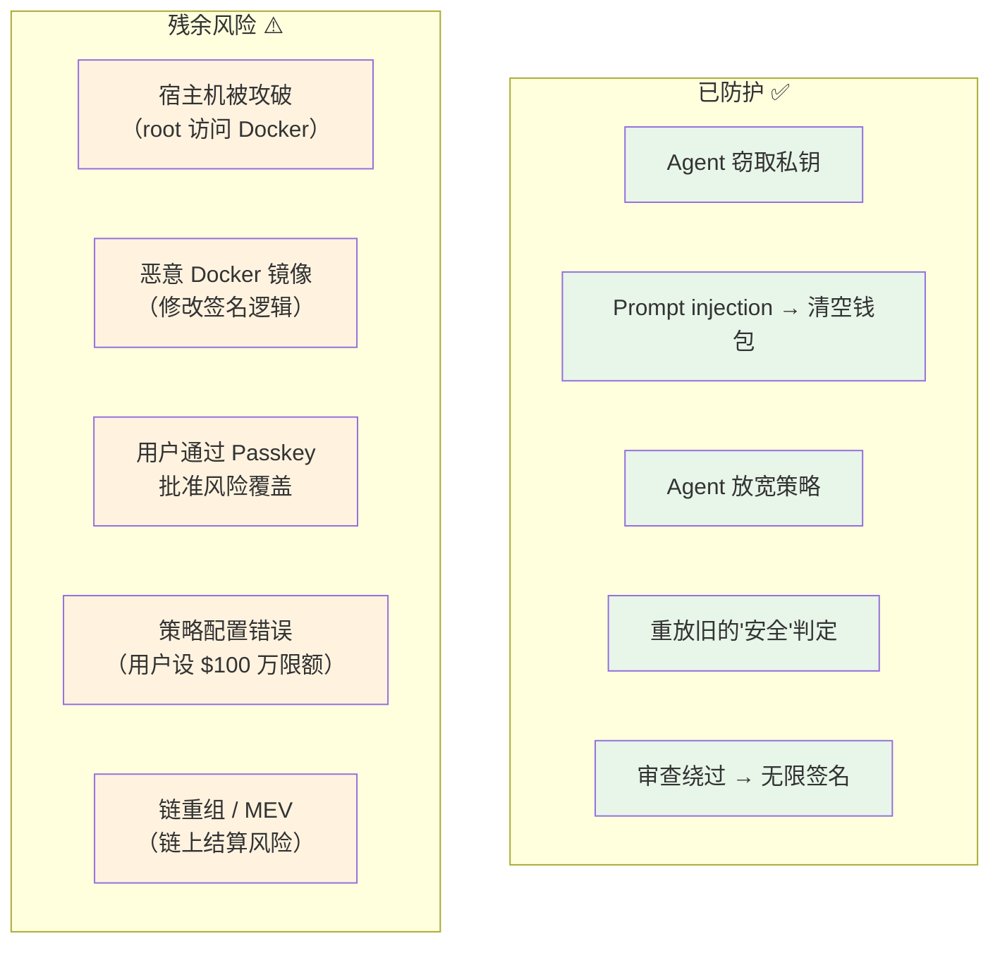

# Web3 Companion 安全设计

[English](SECURITY_DESIGN.md)

## 为什么 Web3 需要 AI Agent，以及为什么现有 Agent 很危险

Web3 的操作复杂度很高。用户需要理解代币授权、Gas 估算、跨链桥路由、EIP-7702 委托、签名策略等概念，还要在多条链上同时操作。一个能查看资产、准备交易、解释安全风险的 AI 助手，能显著降低操作门槛和出错概率。

但是，让 AI Agent 访问加密钱包和让它访问日历、邮件有本质区别。在 Web3 中，**一笔错误的交易是永久性的** —— 没有退款、没有客服撤回、没有回滚。一个恶意签名事件就能在一个区块内清空整个钱包。

### 2026 年 OpenClaw 安全危机

[OpenClaw](https://www.oasis.security/blog/openclaw-vulnerability) —— 那个五天内获得 10 万 GitHub star 的开源 AI Agent —— 的安全事故，完整展示了没有安全边界的 AI Agent 会出什么问题：

- **私钥存在 Agent 内存中。** OpenClaw 把凭据和钱包密钥存在本地 Markdown 文件中，Agent 进程可以直接读取。一封包含 [prompt injection 的邮件](https://www.kaspersky.com/blog/openclaw-vulnerabilities-exposed/55263/)就足以窃取私钥。
- **没有签名隔离。** 读取不可信网页内容的进程，同时拥有签名权限。一个 [1-click RCE 漏洞（CVE-2026-25253）](https://depthfirst.com/post/1-click-rce-to-steal-your-moltbot-data-and-keys)让恶意网页可以完全控制 Agent 及其密钥。
- **市场供应链攻击。** 安全研究人员发现 [ClawHub 市场中 7.1% 的技能插件](https://www.theregister.com/2026/02/05/openclaw_skills_marketplace_leaky_security/)存在凭据泄露缺陷，其中包括主动清空加密钱包的恶意技能。
- **没有策略层。** Agent 签名没有任何基础设施级别的限制。一旦 Agent 被欺骗，从 prompt injection 到资金转移之间没有任何防线。

结果：[超过 135,000 个易受攻击的 Agent 实例被暴露](https://blockeden.xyz/blog/2026/03/12/openclaw-lobster-ai-gateway-web3-security-crisis/)，有记录的钱包被盗和凭据窃取大规模发生。

### 根本问题

核心问题是架构层面的，不是偶发的。LLM 无法可靠地区分指令和数据 —— [系统提示词、用户消息、检索到的网页内容都作为相同的 token 被处理](https://www.blockchain-council.org/ai/prompt-injection-2026-disregard-previous-instructions-web3-security/)。这意味着：

1. **Prompt injection 在模型层面无法完全解决。** 攻击者可以在 Agent 读取的任何内容中嵌入指令 —— 代币名称、合约注释、网页、邮件。如果 Agent 拥有签名权限，注入就变成了资金窃取。
2. **Agent 的安全审查可以被绕过。** LLM 对交易的安全分析完全依赖其上下文。被操纵的上下文 → 被操纵的判断 → 恶意签名。
3. **攻击面是持续的。** Agent 全天候运行，以机器速度处理不可信内容，无需人工审查即可执行操作。任何妥协都会无声地累积。

安全社区的结论很明确：[让 AI 模型直接访问密钥是 Web3 中的高风险赌注](https://www.ccn.com/opinion/technology/ai-models-with-key-access-risky-bet-web3/)。解决方案不是回避 Agent，而是**围绕模型加固架构**，使得被妥协或被欺骗的 LLM 无法造成不可逆的损害。

---

## 设计原则

Web3 Companion 从一开始就基于一个核心假设来设计：**AI Agent 会被欺骗**。架构确保即使 Agent 被完全控制，也无法清空钱包。

### 原则一：Agent 绝不能触碰私钥

私钥是赋予链上资产绝对控制权的唯一凭证。如果 Agent 能读取密钥，Agent 的任何妥协都能获取密钥。

**设计决策：** 私钥只存在于安全签名模块（SSM）内部，这是一个独立的 Go 进程边界。Companion Agent、浏览器前端和 Claude 进程永远不会接收到密钥材料。它们使用交易标识符和钱包 ID —— 不透明的引用，无法用于独立签名。

### 原则二：准备 ≠ 授权

准备一笔交易意图和授权它是根本不同的操作。Agent 可以帮助用户理解状态、构建意图，但签名决策必须通过 Agent 无法绕过的后端控制门。

**设计决策：** 每个写操作都创建一个后端交易意图，必须依次通过七个阶段：委托检查 → 模拟 → 安全检查 → 安全 Agent 审查 → 策略评估 → Passkey 审批 → SSM 签名。每个阶段产生显式状态。前一阶段成功不会跳过后续控制。

### 原则三：审查是检测层，不是执行层

交易模拟、calldata 分析和地址标签查询很有价值 —— 它们能捕获常见攻击模式并向用户解释风险。但它们不是最终安全边界。模拟可能失败，标签可能缺失，LLM 的安全分析可能通过 prompt injection 被操纵。

**设计决策：** 安全审查被视为风险信号和解释层。最终执行层是硬策略 + Passkey。即使所有安全检查都通过，钱包的签名策略仍然生效。即使安全 Agent 说"安全"，如果策略要求人工审批，用户仍然需要通过 Passkey 确认。

### 原则四：硬策略是安全兜底

如果 Agent 被骗请求一笔 10 万美元的转账，安全审查也被操纵说"安全"，**策略仍然必须阻止它** —— 如果每日限额是 1,000 美元。

**设计决策：** 钱包签名策略定义硬性的、代码强制的限制：单笔上限、每日预算、收款人白名单和自动签名阈值。策略不能被 Agent 修改 —— 更改需要 Passkey 审批。新钱包的默认策略关闭自动签名。

### 原则五：不确定时停止

扫描失败不是通过。缺少数据不是安全数据。

**设计决策：** 当安全证据缺失、矛盾、过期或不充分时，系统停止并要求用户明确确认。

---

## 模块一：私钥安全

### 我们面对的问题

我们想要一个能准备链上交易的 AI 助手 —— 但一旦给 Agent 签名能力，就给了它转移真金白银的权力。2025-2026 年每次 Web3 Agent 被黑，都遵循同一模式：Agent 进程持有私钥，攻击者找到了到达它的路径。

我们问自己：**如果 Agent 根本无法签名呢？** 不是"不应该" —— 是*不能*，从架构上。如果私钥存在于 Agent 无论如何被攻破都无法到达的地方呢？

### 决策：不可穿越的边界

我们选择建立一个硬性的进程边界。安全签名模块（SSM）是唯一接触私钥的组件。Agent 通过不透明的意图 ID 通信 —— 它可以说"请签名意图 `txi_abc123`"，但它永远看不到这个请求解锁了什么。

这不是权限检查。这是物理隔离。Agent 的进程内存、环境变量和文件系统中*根本没有*密钥材料。



### 加密方案的选择

我们考虑了三种密钥存储方案：

1. **明文文件。** 快速、简单，但磁盘被攻破就是灾难。否决。
2. **密码派生加密。** 每次重启都需要用户输入密码。对 Docker 服务来说体验太差。否决。
3. **信封加密。** 每个钱包密钥用唯一的数据密钥加密。数据密钥本身由主密钥（AWS KMS 或本地 AES-256）加密。即使加密文件被盗，没有主密钥也无法解密。

我们选择了信封加密，两种模式，同一接口：



关键洞察：在 AWS KMS 模式下，窃取服务器只能得到没有 AWS 凭据就无法解密的加密 blob。私钥只在 SSM 进程内存中以明文形式存在，仅持续一次签名操作的时长，然后被清零。

### 签名请求的完整路径

每个签名请求走相同的路径。没有捷径，没有跳过检查的"快速通道"：



### 唯一的例外：钱包导出

我们曾争论是否要包含导出功能。支持的理由：想离开 Web3 Companion 的用户应该能带走自己的密钥。反对的理由：任何密钥暴露都是风险。

妥协方案：导出需要 Passkey，显示一次密钥，**立即从管理中移除该钱包**。一旦导出，Web3 Companion 不再为该钱包签名。用户正在接管保管权 —— 我们不再参与。

---

## 模块二：交易安全

### 我们面对的问题

即使私钥隔离做得完美，被攻破的 Agent 仍然能造成损害：它可以准备*看起来合法*的交易意图，欺骗用户或利用自动签名策略。Prompt injection 不需要私钥 —— 如果它能说服系统通过正常渠道签名一笔恶意交易。

我们需要回答：**当准备交易的实体可能在对你撒谎时，你如何捕获一笔坏交易？**

### 核心洞察：没有单一层级是足够的

我们考虑了几种方案：

- **仅交易模拟。** 模拟交易，检查结果。问题：模拟可能失败，RPC 可能不可用，新型攻击不会匹配已知模式。
- **仅 LLM 安全审查。** 让 AI 分析交易。问题：导致坏交易的同一个 prompt injection 也可以操纵审查。
- **仅硬策略。** 每笔交易限额 $100。问题：合法用户需要灵活性。swap 限额 $100 是不必要的限制。

单独一种都不够。但**组合**起来，它们创造了一个每层都能捕获其他层遗漏的防御：



关键设计决策：**每一层都假设前一层已被完全攻破。** 第 2 层不信任第 1 层的判定。第 3 层不信任第 2 层的策略评估。这是纵深防御，不是串联防御。

### 第 1 层：安全审查 —— "这笔交易安全吗？"

安全审查层在交易构建之后、签名之前运行 14 项确定性检查。每项检查针对一种特定攻击模式：



**但我们知道仅靠审查不够。** 当 prompt injection 告诉安全 Agent"这个 DELEGATECALL 是预期行为" —— Agent 也相信了 —— 审查层就被绕过了。这时策略层就是救命稻草。

### 第 2 层：签名策略 —— "这笔交易被允许吗？"

这是硬性安全边界。钱包签名策略是**代码强制的，不是 LLM 决定的**。Agent 无法修改它、推理它或与它争辩。它是一组数值限制，由 Go 服务器评估 —— LLM 不参与。



关键设计选择：

**为什么策略更改需要 Passkey。** 如果 Agent 能修改策略，prompt injection 可以先放宽限制，再清空钱包。要求 Passkey 修改策略，意味着攻击者需要用户的物理生物识别 —— 不仅仅是控制 Agent。

**为什么自动签名默认关闭。** 新钱包获得 `default` 手动策略。每笔交易都需要 Passkey，直到用户显式启用自动签名并设置限额。

### 第 3 层：Passkey —— "人类确认了吗？"

当策略要求"人工审批"时，系统创建一个 WebAuthn 挑战。这是最终的门 —— 纯软件无法通过。



### 交易意图状态机

我们从 DeFi 攻击中学到，最危险的模式之一是"判定重用" —— 把旧的"安全"判定应用于修改后的交易。为防止这种情况，每个写操作创建唯一的意图，有显式状态转换：



安全审查仅清除其审查的**确切意图**。如果 Agent 重新构建交易（不同 calldata、不同金额、不同收款人），那就是新意图，从 `built` 开始，必须再次通过所有检查。

---

## 模块三：随机数生成 (RNG)

### 我们面对的问题

Web3 Companion 中的每个密码学操作都依赖不可预测的随机数：私钥生成、AES-GCM nonce 创建、认证令牌发放、WebAuthn 挑战字节、以及密钥加密密钥派生。任何一个环节的 RNG 出现弱点或可预测性，都会破坏整个安全架构 —— 有偏差的私钥可被暴力破解，重复使用的 nonce 会泄露 AES 密钥，可预测的挑战值使重放攻击成为可能。

OpenClaw 代码库在多个安全关键路径上使用了 `math/rand`（一个以系统时钟为种子的确定性伪随机数生成器）。研究人员证明，攻击者只需观察连续两个令牌值就能重建 PRNG 状态，从而预测所有后续的令牌、挑战值，在某些分支中甚至包括钱包密钥。

### 决策：crypto/rand 全覆盖，无例外

我们执行一条简单的规则：**系统中的每一个随机字节都来自 `crypto/rand`**。这是 Go 标准库对操作系统密码学安全伪随机数生成器（CSPRNG）的接口，在 Linux 上由 `getrandom(2)` 提供支持。

安全关键代码库中没有任何 `math/rand` 导入。这通过测试和 CI 秘密扫描强制验证。

### 随机数使用位置

| 操作 | 字节数 | 来源 | 错误处理 |
|------|--------|------|----------|
| 私钥生成 (secp256k1) | 32 | `crypto.GenerateKey()` → `crypto/rand.Reader` | 错误传播；钱包创建失败 |
| AES-256-GCM nonce | 12 | `io.ReadFull(rand.Reader, nonce)` | 错误传播；加密失败 |
| AES-256 数据密钥 | 32 | `io.ReadFull(rand.Reader, key)` | 错误传播；密钥生成失败 |
| JWT 密钥（自动生成） | 64 | `rand.Read(b)` | 错误传播；服务器启动失败 |
| SSM 根密钥（自动生成） | 32 | `rand.Read(b)` | 错误传播；服务器启动失败 |
| 刷新令牌 | 32 | `rand.Read(b)` | 错误传播；令牌发放失败 |
| WebAuthn 挑战 | 32 | `rand.Read(b)` | Panic（CSPRNG 故障 = 不安全状态） |
| 挑战 ID | 16 | `rand.Read(b)` | Panic |
| 认证令牌 / 会话 ID | 32 / 12 | `rand.Read(b)` | Panic |
| 请求 ID | 16 | `rand.Read(b)` | Panic |
| 安全文件删除覆写 | 文件大小 | `rand.Read(randomData)` | 错误传播；删除中止 |

### 错误处理策略

我们根据操作类型使用两种错误处理策略：

1. **错误传播**：用于调用方可以优雅处理失败的操作（密钥生成、加密、令牌发放）。操作干净地失败，调用方收到错误。

2. **Panic**：用于 CSPRNG 故障意味着进程处于不安全状态、后续密码学操作均不可信的操作（挑战生成、会话令牌）。在 Go 1.22+ 上，`crypto/rand.Read` 被文档记录为在所有支持平台上永不返回错误，因此这个 panic 路径在实践中不可达 —— 但它确保了在不可能发生的情况下，进程会停止而不是静默使用可预测的输出。

### 密钥派生

本地模式的密钥加密密钥（KEK）从用户提供的 `WEB3_SSM_KEY` 通过 HKDF（基于 HMAC 的提取-扩展密钥派生函数，RFC 5869）派生：

```
KEK = HKDF-SHA256(
    IKM  = WEB3_SSM_KEY,
    salt = "web3-companion:ssm",
    info = "kek-derivation:v1"
)  →  32 字节 (AES-256)
```

HKDF 是从高熵输入材料派生密钥的标准 KDF。salt 提供域分离（为此应用派生的密钥不会与使用相同根密钥的其他应用产生碰撞），info 字符串提供上下文绑定（KEK 派生与未来可能添加的任何派生都是不同的）。

根密钥最小长度为 32 字节（256 位），在启动时强制检查。当由设置流程自动生成时，根密钥是 32 字节的 `crypto/rand` 输出，提供 256 位的熵。

### Nonce 管理

AES-256-GCM 要求在同一密钥下每次加密使用唯一的 nonce。我们从 `crypto/rand.Reader` 生成每个 nonce（12 字节随机数）。使用 96 位随机 nonce，生日碰撞概率在同一密钥下约 2^48 次加密后达到 2^-32 —— 远超此系统中任何单个数据密钥的操作生命周期，因为每个数据密钥仅加密一个私钥。

### 我们明确避免的做法

- **`math/rand`** —— 确定性 PRNG，不适用于任何安全目的
- **基于时间的种子** —— 可观察且可预测
- **Nonce 计数器** —— 需要持久状态，跨重启可能失同步
- **密钥重用** —— 每个钱包私钥都有自己唯一的数据密钥
- **自定义 CSPRNG 实现** —— 我们完全使用操作系统提供的熵源

---

## 审计性

安全事件如果不能事后审查就毫无意义。系统记录：账户注册和登录、钱包创建/删除/导出、策略创建和修改、交易意图生命周期、安全判定和覆盖、Passkey 挑战创建和完成、签名和广播结果。

---

## 哪些风险仍然存在



---

## 回到最初的问题

让我们回到最初提出的问题：**如何构建一个即使被完全攻破也无法清空钱包的 Web3 AI Agent？**

答案不是某一个机制 —— 而是三个互不信任的独立边界之间的协作。

**私钥边界**确保 Agent 永远没有签名的原始材料。即使攻击者完全控制了 Companion 进程 —— 读取其内存、修改其代码、拦截每条消息 —— 他们找不到密钥。他们可以构造世界上最有说服力的交易意图，但他们自己签不了。

**策略边界**确保即使看起来合法的意图也面对硬性数值限制。一个 prompt injection 可能说服安全审查认为一笔 5 万美元的转账是安全的。没关系 —— 如果每日预算是 1,000 美元，交易就会被拒绝。策略由 Go 代码评估，不由 LLM 评估。攻击者需要先修改策略，但这需要……

**Passkey 边界**确保每个敏感决策都有人类物理在场。策略更改、手动签名、钱包导出、安全覆盖 —— 全部需要硬件绑定的生物识别挑战，没有任何软件漏洞可以模拟。

每个边界都被设计为能独立守住。如果安全审查完美无缺，策略和 Passkey 是冗余的安全网。如果安全审查被完全绕过，策略仍然强制执行硬性限制。如果审查和策略都被击穿，Passkey 仍然需要用户的指纹。

这种分层方式是我们对 Web3 AI Agent 根本矛盾的回答：**用户想要自动化的便利，但区块链的不可逆性要求比任何单一机制都更强的安全保证。**

| 如果这个被攻破…… | 这些仍然保护你 |
|----------------|-------------|
| Agent（prompt injection、RCE） | 无密钥 → 不能签名。策略 → 不能超限。Passkey → 不能审批。 |
| 安全审查（判定被操纵） | 策略 → 无论如何强制限制。Passkey → 手动审批仍然需要。 |
| 策略（用户配置错误） | Passkey → 每个需要手动的操作仍需生物识别。 |
| 除 Passkey 外的一切 | 硬件绑定凭据 → 攻击者需要用户的物理身体。 |

---

*Web3 Companion 是开源研究版本，尚未完成完整的生产级安全审计。本文档描述系统设计目标和实现边界，不构成安全承诺。*

*参考资料：*
- *[AI Models with Key Access Are a Risky Bet for Web3](https://www.ccn.com/opinion/technology/ai-models-with-key-access-risky-bet-web3/) — CCN*
- *[ClawJacked: OpenClaw Vulnerability Enables Full Agent Takeover](https://www.oasis.security/blog/openclaw-vulnerability) — Oasis Security*
- *[Prompt Injection in 2026 for Web3 Security](https://www.blockchain-council.org/ai/prompt-injection-2026-disregard-previous-instructions-web3-security/) — Blockchain Council*
- *[OpenClaw's 'Lobster Fever' Became Web3's Biggest Security Wake-Up Call of 2026](https://blockeden.xyz/blog/2026/03/12/openclaw-lobster-ai-gateway-web3-security-crisis/) — BlockEden*
- *[Agentic AI Security Risks in Web3](https://sherlock.xyz/post/agentic-ai-security-risks-in-web3-what-protocols-need-to-know-in-2026) — Sherlock*
- *[As AI agents scale in crypto, researchers warn of a critical security gap](https://www.coindesk.com/tech/2026/04/13/ai-agents-are-set-to-power-crypto-payments-but-a-hidden-flaw-could-expose-wallets) — CoinDesk*
