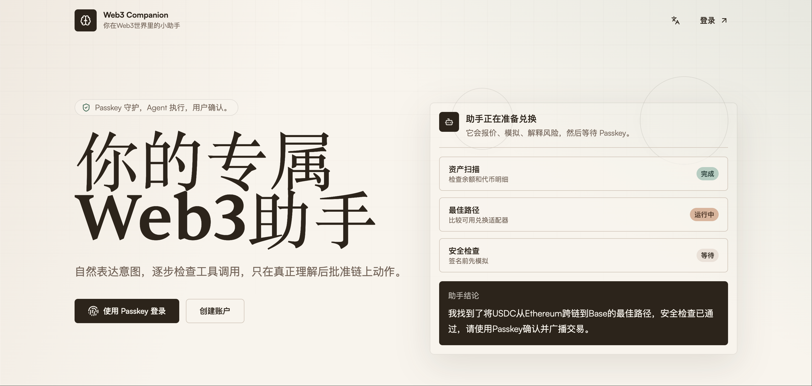
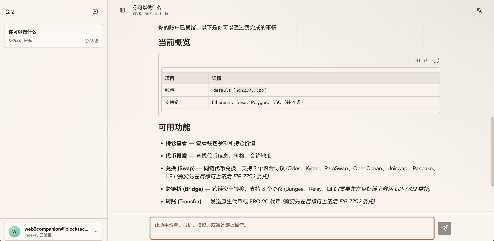
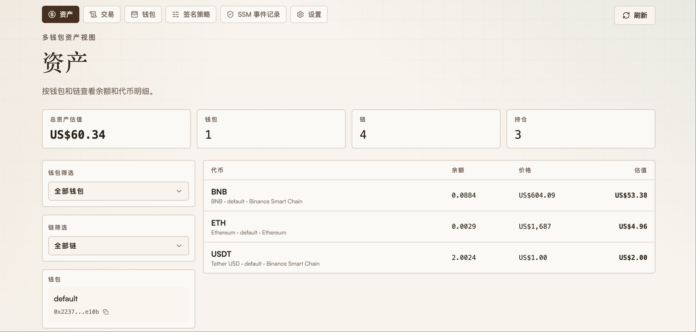
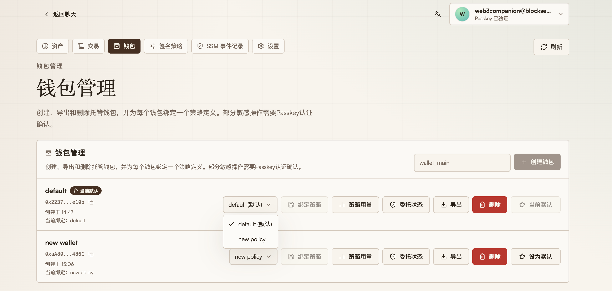
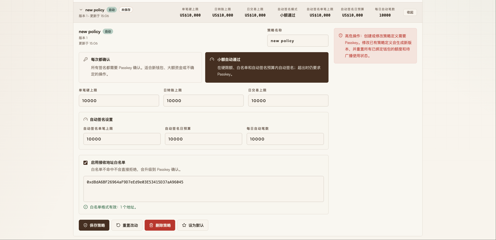
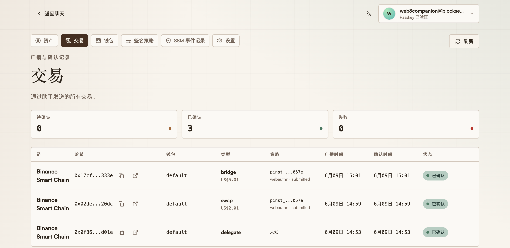
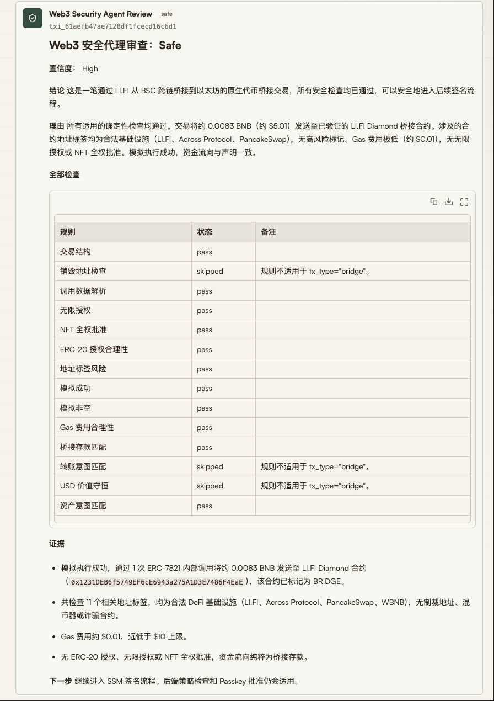
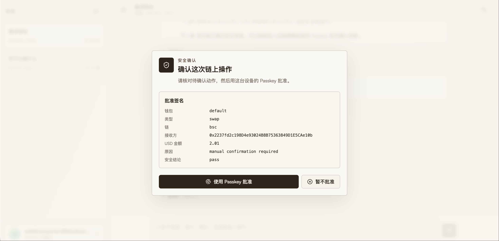
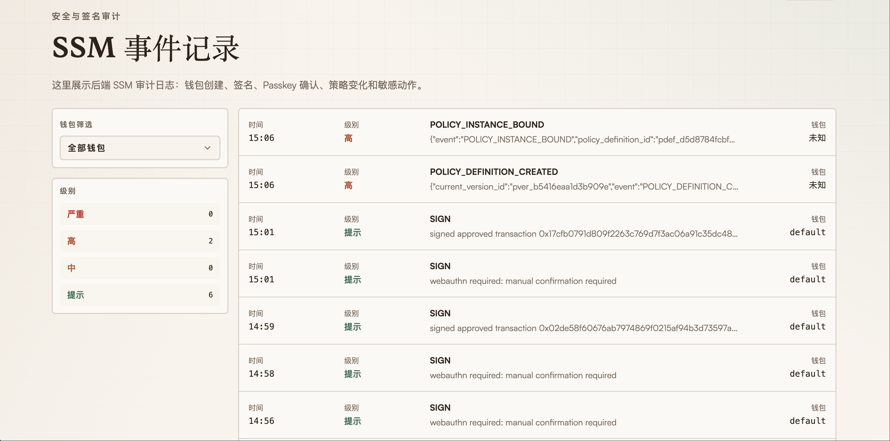

# Web3 Companion User Manual

[简体中文](USER_GUIDE.zh.md)

This manual explains how to install, configure, and use Web3 Companion — a secure agentic wallet for autonomous on-chain operations.

Web3 Companion runs in your own environment. It gives you a browser app for portfolio review, wallet management, policy control, transaction preparation, security review, and Passkey-confirmed signing.



## 1. Core Ideas

Web3 Companion is designed around a few explicit safety boundaries:

- You run the service yourself.
- Email identifies the account.
- Passkey is required for account access and sensitive approvals.
- Wallet private keys are stored by the local Secure Signature Module, not by the assistant process.
- The assistant can prepare actions and request signing, but sensitive writes go through backend policy, security checks, and Passkey approval.
- All wallets are EIP-7702 managed wallets.

## 2. Requirements

For basic usage:

- Docker.
- A browser with WebAuthn Passkey support.
- An LLM provider key.
- RPC endpoints for the chains you want to use.

For write actions:

- Native token on the wallet and target chain for gas.
- EIP-7702 delegation completed on the target chain.
- A signing policy that permits the action, or a manual Passkey approval.

Default chains:

| Chain | Chain ID | Native token |
| --- | ---: | --- |
| Ethereum | 1 | ETH |
| Base | 8453 | ETH |
| Polygon | 137 | POL |
| BSC | 56 | BNB |

## 3. Installation Options

### 3.1 Run the Published Docker Image

The simplest path is:

```bash
docker run -d \
  --name web3-companion \
  -p 8081:8081 \
  -v web3-data:/home/web3 \
  blocksecteam/web3-companion
```

Open:

```text
http://localhost:8081
```

The first-run Setup Wizard will guide you through configuration. This path does not require an `.env` file.

Common options:

```bash
# Custom HTTPS domain for Passkey binding
docker run -d --name web3-companion \
  -p 8081:8081 \
  -v web3-data:/home/web3 \
  -e WEB3_EXTERNAL_URL=https://companion.example.com \
  blocksecteam/web3-companion

# AWS KMS wallet encryption
docker run -d --name web3-companion \
  -p 8081:8081 \
  -v web3-data:/home/web3 \
  -e AWS_REGION=us-east-1 \
  -e AWS_KMS_KEY_ID=arn:aws:kms:us-east-1:123456789:key/your-key-id \
  -e AWS_ACCESS_KEY_ID=AKIA... \
  -e AWS_SECRET_ACCESS_KEY=... \
  blocksecteam/web3-companion

# Custom host port
docker run -d --name web3-companion -p 9090:8081 -v web3-data:/home/web3 blocksecteam/web3-companion
```

For non-localhost deployments, put an HTTPS reverse proxy in front and set `WEB3_EXTERNAL_URL` to the browser-visible origin. Passkeys bind to that origin.

All four AWS KMS variables must be set together. Without them, wallet keys are encrypted locally with an auto-generated AES-256 key stored in SQLite.

### 3.2 Run From Source

From a source checkout:

```bash
cd docker
./start.sh
```

`start.sh` builds the image, prepares the data directory, and starts Docker Compose. It does not require `docker/.env` or `docker/config.toml`.

LLM, RPC, and optional provider keys are configured through the Setup Wizard or the authenticated Settings page. Deployment overrides can be passed as shell environment variables, for example:

```bash
WEB3_PORT=8082 WEB3_EXTERNAL_URL=https://companion.example.com ./start.sh
```

Open:

```text
http://localhost:8081
```

Use a different local port:

```bash
WEB3_PORT=8082 ./start.sh
```

Docker Compose binds the browser port to `127.0.0.1` by default.

## 4. First-Run Setup Wizard

The Setup Wizard appears when the service has no registered user yet.

It configures:

1. Instance security keys.
2. Chain RPC endpoints.
3. LLM provider.
4. Optional data providers.
5. First account with email and Passkey.
6. Setup completion.

### 4.1 Security Keys

Web3 Companion generates instance secrets when needed. Save them if the wizard shows them.

These secrets protect local state. If the container volume is lost, they may be needed to recover encrypted data.

Do not commit generated secrets to Git.

### 4.2 RPC Configuration

Each enabled chain needs a matching RPC endpoint. The server verifies that the RPC endpoint reports the expected chain ID.

Public default RPCs may work for basic use, but security review is strongest with trace-capable RPC endpoints.

Use provider RPCs that support `debug_traceCall` when possible. Examples include paid tiers from providers such as Alchemy, Infura, or QuickNode.

### 4.3 LLM Configuration

Configure:

- provider
- base URL
- model name
- API key

The key can be entered during setup or later in Settings. Model auth is written to per-user Claude Agent SDK settings, not passed to the assistant through raw process environment.

### 4.4 Optional Data Providers

Optional provider keys improve data quality:

- Portals: portfolio, token metadata, prices, and token decimal resolution.
- MetaSleuth: address labels and risk context used by security checks.

### 4.5 Account Registration

Create the first account with:

- email
- Passkey registration
- Passkey login confirmation

Passkey works on `localhost`. For non-localhost deployments, use HTTPS and configure the external URL / relying-party settings correctly.

## 5. Browser App Overview

After login, the application exposes product sections for chat, portfolio, wallets, policies, transactions, settings, and audit.



### 5.1 Chat Workspace

Use chat to ask the assistant about assets and prepare on-chain actions.

Examples:

```text
What assets do I have?
Transfer 0.01 ETH to 0x...
Swap 25 USDC to ETH on Base.
Find a route to bridge USDC from Ethereum to Polygon.
Explain the security checks for my pending transaction.
```

The assistant may call packaged Web3 skills and the internal `web3` CLI. Sensitive operations still require backend validation, policy checks, and Passkey approval.

### 5.2 Portfolio

The Portfolio page shows wallet balances and chain/token breakdowns.



Use it to:

- inspect holdings across supported chains
- confirm a wallet has native gas token
- review token balances before transfer, swap, or bridge
- detect whether a wallet can be safely deleted

### 5.3 Wallets

The Wallets page manages local wallets.



Common actions:

- view wallet addresses
- set the default wallet
- bind wallet policies
- export a wallet
- delete a wallet

Wallet export and deletion require Passkey approval. Export shows the private key once and removes that wallet from management. Save it securely before leaving the page.

Deletion is blocked when a recent portfolio check shows assets above the configured small dust threshold.

### 5.4 Policies

Policies control how signing is approved.



New wallets receive the predefined `default` manual policy. Auto-sign is off by default.

Depending on policy configuration, actions may require manual Passkey approval or may be eligible for auto-sign within limits. Policy changes require Passkey approval.

### 5.5 Transactions

The Transactions page shows submitted and tracked transaction records.



Use it to:

- inspect transaction state
- open external explorers when available
- review submitted hashes
- diagnose pending or failed actions

### 5.6 Security Review

Before signing, Web3 Companion runs transaction simulation and security checks.



Static verdicts are:

- `pass`
- `warn`
- `fail`

A scan failure is not treated as pass.

When configured, the Security Agent reviews the static verdict and transaction context. A safe review with medium or high confidence can clear the exact backend intent for signing when backend configuration allows it. Policy and Passkey controls still apply.

### 5.7 Passkey Confirmation

Sensitive actions pause for Passkey confirmation.



Passkey approval is required for:

- registration
- login
- policy changes
- wallet deletion
- wallet export
- manual signing approvals

### 5.8 Audit Logs

Audit logs capture important account and security events.



Use audit logs to review:

- login and setup events
- policy changes
- wallet lifecycle events
- signing and security override events

## 6. Wallet Model

All wallets are EIP-7702 managed.

- Wallets delegate to MetaMask delegator `0x63c0c19a282a1b52b07dd5a65b58948a07dae32b`.
- Non-EIP-7702 wallets are rejected.
- Protocol writes, ERC-20 writes, and native transfers produce ERC-7821 `execute(bytes32,bytes)` calldata.
- Delegation is checked before write builds.

If a write build returns `not_delegated`, run the explicit delegation flow first.

## 7. Delegation and Gas

A new wallet needs native token on the target chain before initial delegation.

Do not estimate the amount from memory. Preview it with:

```bash
web3 ssm delegate-estimate --wallet <wallet_id> --chain <chain>
```

If delegation fails with `insufficient_gas`, add native token to that wallet on that chain and retry.

Delegation is separate from the eventual signed operation. Even after delegation succeeds, the actual transfer, swap, or bridge still goes through build, security review, policy, and Passkey approval when required.

## 8. Common Workflows

### 8.1 Check Assets

Use Portfolio or ask:

```text
What assets do I have?
```

Before write actions, confirm:

- the wallet has the token being spent
- the wallet has native gas token
- the target chain is enabled and has a working RPC

### 8.2 Transfer Native Token

Ask:

```text
Transfer 0.01 ETH to 0x...
```

Expected stages:

1. Assistant prepares the intent.
2. Backend checks delegation.
3. Backend runs security checks.
4. Policy is applied.
5. Passkey approval may be requested.
6. SSM signs and broadcasts.

### 8.3 Transfer ERC-20 Token

Ask:

```text
Transfer 25 USDC to 0x... on Base.
```

ERC-20 transfers use ERC-7821 batch calldata. Token resolution and decimals matter. If a symbol is ambiguous, use the token address.

### 8.4 Swap

Ask:

```text
Swap 25 USDC to ETH on Base.
```

The assistant may quote first, then build the selected route. Slippage must be explicit or use the configured default. The final transaction still goes through security checks and signing controls.

### 8.5 Bridge

Ask:

```text
Bridge 50 USDC from Ethereum to Polygon.
```

Bridge routes can involve multiple providers and chains. Confirm:

- source chain
- destination chain
- source token
- destination token
- amount
- recipient wallet
- expected fees

### 8.6 Security Override

If a transaction is blocked by a warning, failure, or scan problem, the app may ask for explicit confirmation or security override.

Only approve an override when you understand:

- what changed on-chain
- what assets leave the wallet
- who receives them
- whether allowances or approvals are created
- whether address labels or risk signals are acceptable

## 9. Settings Reference

### 9.1 LLM Provider

Fields:

- provider
- base URL
- model name
- API key

The app can verify the configuration before saving.

### 9.2 RPC Endpoints

Each chain has an RPC URL. RPC URLs are verified against chain IDs.

For security review, prefer RPC endpoints that support trace APIs.

### 9.3 Data Providers

Portals improves portfolio and token data.

MetaSleuth improves address-label context for security checks.

### 9.4 External URL and Passkey

For non-localhost deployments, configure:

- `WEB3_EXTERNAL_URL`
- `WEB3_RP_ID`
- `WEB3_RP_ORIGIN`

Use HTTPS outside localhost.

## 10. Data Storage

Inside the container:

| Path | Purpose |
| --- | --- |
| `/home/web3/web3.db` | SQLite database |
| `/home/web3/keys/` | encrypted wallet key files |
| `/home/web3/settings/` | runtime LLM and RPC settings |
| `/home/web3/companion/users/<user-id>/` | per-user companion home |
| `/home/web3/logs/web3.log.jsonl` | rotating JSONL server log |

For source-based Docker Compose, host data defaults to:

```text
docker/data-8081
```

Back up the data volume if you rely on the instance.

## 11. Optional CLI

Most users should use the browser app.

The Docker image includes the `web3` CLI for companion/container-internal tooling. Authenticated write and execution commands require backend-issued container credentials and are intended to run inside the companion runtime.

From a source checkout with the service running:

```bash
docker compose -f docker/compose.yml exec web3 web3 --help
```

Command groups:

```text
web3 portfolio
web3 token
web3 chain
web3 swap
web3 bridge
web3 security
web3 ssm
```

## 12. Troubleshooting

| Symptom | What to check |
| --- | --- |
| Model authentication is missing | Configure the LLM provider key in the Setup Wizard or Settings. |
| RPC chain ID validation fails | Make sure each RPC URL points to the configured chain. |
| Passkey fails outside localhost | Use HTTPS and set `WEB3_EXTERNAL_URL`, `WEB3_RP_ID`, and `WEB3_RP_ORIGIN`. |
| `not_delegated` | Run the explicit delegation flow first. |
| `insufficient_gas` | Add native token to the wallet on that chain. |
| Security check fails or cannot scan | Treat it as not safe until reviewed or explicitly confirmed. |
| Wallet deletion is blocked | Check portfolio value; deletion is blocked above the configured dust threshold. |

## 13. Safety Checklist

Before approving a write:

- Confirm the wallet.
- Confirm the chain.
- Confirm the recipient.
- Confirm the token and amount.
- Confirm fees and native gas balance.
- Read security warnings.
- Do not approve unknown calldata or unclear asset movement.
- Do not export a wallet unless you are ready to store the private key securely.
